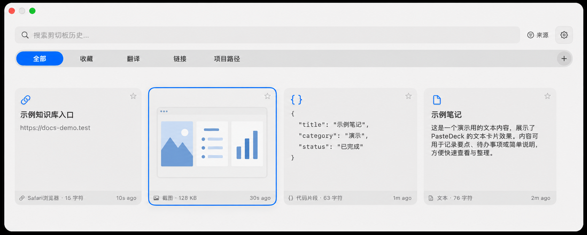
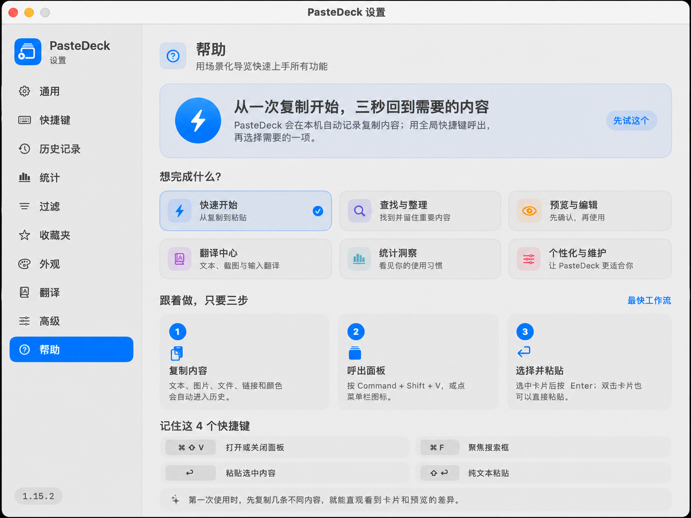
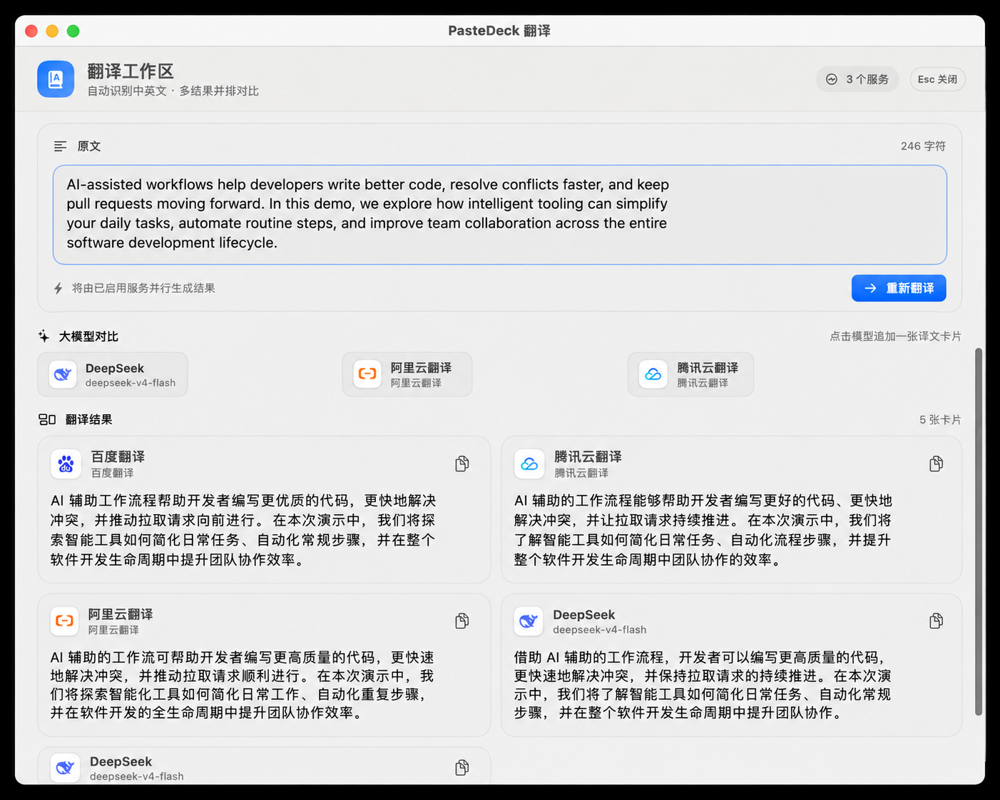
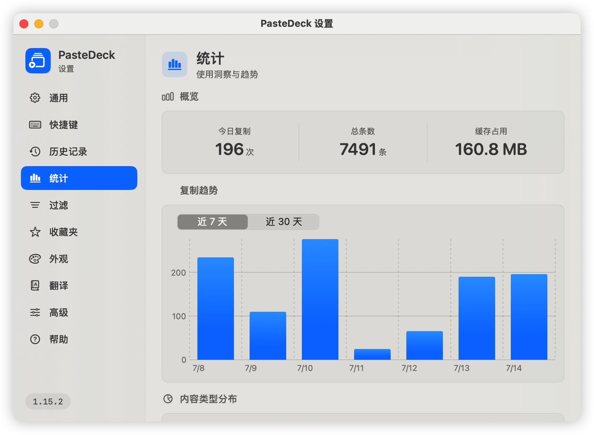
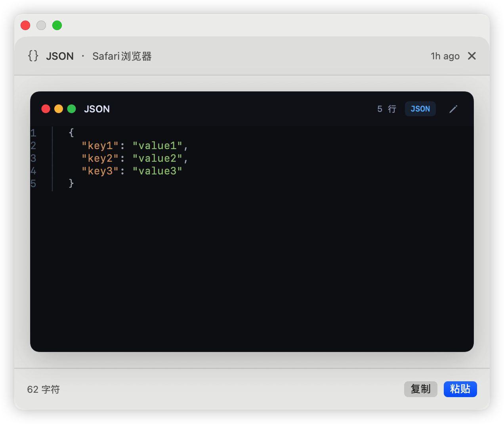

# PasteDeck 2.0

PasteDeck 2.0 is a native macOS productivity workbench, smart toolbox, and clipboard manager. It combines a full 3-column efficiency workspace for deep search, inspection, and tool execution with a lightweight, high-speed floating panel for everyday quick pasting.



## Highlights

- **Dual-Surface Architecture**:
  - **Full macOS Workbench** (`Command + K` / Menu bar -> 打开工作台): Independent, resizable 3-column native window (1080 × 720 pt) featuring a navigation sidebar, high-density content list/grid, and a live context inspector.
  - **Quick Paste Panel** (`Command + Shift + V` / Menu bar -> 快速粘贴面板): Lightweight, non-activating floating panel with instant keyboard navigation (arrow keys, `Shift`+arrow multi-selection, Enter to paste — batch paste for multi-selection, Esc to dismiss), click-to-select rows, opens with the second row pre-selected, and quick tool execution.
- **Unified Search**: Search both Builtin Tools and Clipboard History simultaneously with a unified keyboard index (`↑`/`↓`), automatic content recognition suggestions, and instant execution on `Enter` (pastes clipboard records, opens tools in standalone native windows).
- **Context Inspector**: Right-side inspector displays real-time content previews, metadata, quick actions (Copy, Paste Plain Text, Preview), and smart tool recommendations based on strict content recognition (e.g. Unix timestamps, IPv4 addresses, and CIDR subnets).
- **Built-in Smart Toolbox & Tool Center**: Standalone tools discovered dynamically from `ToolRegistry` with independent AppKit windows:
  - **Time & Date Calculator**: Unix timestamp bi-directional conversion, date difference, date arithmetic, holiday-aware working days, English date formats, world time, and stopwatch.
  - **IPv4 / Subnet Calculator**: IP validation, address classes, CIDR prefix calculations, subnet masks, usable host ranges, and optional IP geolocation.
  - **Quota Overview**: Real-time local Codex (ChatGPT desktop) rate-limit windows and Tencent WorkBuddy credits.
- **Frosted-Glass Workbench Motion** (macOS 14+, no macOS 26 dependency):
  - **Sliding selection capsule**: The sidebar's current item is marked by a translucent glass capsule that slides to its new position when you switch sections — stretching along the direction of travel mid-flight and settling with a springy rebound. It travels across the "Smart Categories" group header without clipping.
  - **Glass module cards**: Tool Center cards use frosted glass; on hover a soft light spot follows the cursor, the border nearest the cursor brightens locally, and the card tilts slightly in 3D. Moving away restores it smoothly.
  - **In-place module detail**: Clicking a tool module expands it in place into a detail view with the embedded tool interface, while the other modules collapse into a bottom glass thumbnail strip. Click a thumbnail to switch; close to collapse back along the same path.
  - All motion respects **System Settings → Accessibility → Display → Reduce Motion**, degrading to instant state changes.

  > **Implementation note.** Glass needs two layers to read as glass: a coloured ambient gradient behind everything for the material to refract, and a low-opacity milky surface plus a real drop shadow on top. Material alone is not enough — inside a window it samples a near-uniform background, which renders as a flat grey slab. The same warning applies to tint: a high-opacity colour painted over the material hides it completely and yields a solid block.
- **Pure Native Design Language**: Automatically follows macOS system Light and Dark appearance with native materials, contrast-safe semantic colors, and PasteDeck's brand orange accent (`#FF7314`).
- Records clipboard history for text, rich text, links, Markdown, JSON, images, files, and colors.
- Shows website names for link cards and lets link history be searched by site name. Automatically fetches webpage titles for copied links.
- Opens from the menu bar or the global shortcut `Command + Shift + V`.
- Login launches remain silent in the menu bar; reopening the running app shows the clipboard panel or workbench.
- Click an item to select it, or double-click it to paste or open immediately.
- Menu bar dropdown includes a stats overview header showing today's copies, total items, and cache size, plus a quota block with progress bars for Codex 5-hour/weekly windows and WorkBuddy remaining credits, a one-click refresh, and shortcuts to the workbench, quick panel, and settings.
- Shows local quota balances in a dedicated settings pane: Codex (ChatGPT desktop) plan status, 5-hour and weekly rate-limit windows, and rate-limit reset credits are queried through the local codex app-server without network access; WorkBuddy (Tencent CodeBuddy) per-package totals, usage, and remaining credits are read from the local desktop credential file and fetched directly from Tencent's official billing endpoint with automatic token renewal. An optional settings toggle displays compact balances (`C` remaining percent and `W` remaining credits) next to the menu bar icon, turning red when a balance runs low.
- Includes a visual, scenario-based Feature Guide in Settings and the menu bar, covering everyday actions, organization, previews, translation, analytics, and maintenance without a wall of text.
- Provides fast keyboard navigation that keeps the selected card fully visible at every panel size, plus favorite filters, custom collections, pinning, deletion, and batch paste.
- Preserves RTF data for rich text paste and supports plain-text paste with `Shift + Command + V` or `Shift + Enter`.
- Renders Markdown, JSON, code snippets, images, image files, file metadata, links, and colors in the preview window.
- Runs OCR for copied images so recognized text can be searched later.
- Supports editable previews for text, code, and colors.
- Includes a dedicated translation center with opt-in automatic selected-text translation windows, `Option + D` selected-text translation, `Option + S` screenshot OCR translation, and `Option + A` input translation; screenshot selection is based on a fixed screen image so overlapping app windows are captured correctly, immediately accepts drag or `Esc`, and shows a brief selection hint. Shortcuts are customizable.
- Text previews open the unified translation workspace from the Translate button or `T`. `Escape` and `Command + W` both close it and return focus to the clipboard panel.
- Supports multiple saved keys for Baidu, Tencent Cloud, Youdao, and Alibaba Cloud. Credentials are stored in the local macOS Keychain; SwiftData stores only configuration metadata and credential references. One key per provider can be enabled at a time, while enabled providers translate in parallel into comparable, independently scrollable result cards. OpenAI-compatible LLM calls add a new result card instead of replacing an existing translation; connection tests report availability and latency.
- The translation workspace keeps source-language detection automatic and adds a target-language menu with automatic routing plus 20 common languages. API and LLM cards share the selected target, record the actual target in history, and report unsupported provider/language combinations without sending an invalid request. Translation actions stay inside the source card, while configured LLMs remain direct comparison choices.
- Translation settings, model choices, and result cards show locally bundled provider logos for Baidu, Tencent Cloud, Youdao, Alibaba Cloud, DeepSeek, GLM, Kimi, MiMo, OpenAI, MiniMax, and Qwen. Logo files are cached in memory and never fetched at runtime.
- `Option + D` fallback probes are globally serialized and restore the original multi-format clipboard. Automatic translation may use this bounded fallback only after a real mouse selection; keyboard-created selections never trigger automatic translation.
- Automatic selected-text translation requires both Accessibility and Input Monitoring. The settings page reports Input Monitoring status and opens the matching System Settings page; with permission, a recoverable event tap reliably observes mouse selections in other apps. Selections containing only numbers, symbols, whitespace, or emoji do not open a translation bubble.
- Closing an automatic translation window does not reopen it while the original text remains selected. A new mouse selection opens translation again, even when it contains the same text.
- Statistics panel with daily/30-day trends, type distribution, source app insights, extreme records, and daily translation usage by provider, key fingerprint, and LLM model/token count.
- Stores history locally with SwiftData and caches images under `~/Library/Caches/PasteDeck/images/`. Image assets use SHA-256 content-addressed filenames; pending adoption, final-reference deletion, and maintenance share one serialized boundary so a concurrent cleanup cannot remove an image before its history record is saved.

## Screenshots / 界面预览

### Feature Guide / 功能指南



### Translation Workspace / 翻译工作区



### Usage Insights / 使用洞察



### Content Preview / 内容预览



## Installation

### Download

1. Download the latest `PasteDeck-*.dmg` from [Releases](https://github.com/wq247934/paste-deck/releases).
2. Open the DMG.
3. Drag `PasteDeck.app` into Applications.
4. Launch PasteDeck from Applications.

### Build From Source

```bash
git clone https://github.com/wq247934/paste-deck.git
cd paste-deck
open Package.swift
```

Build and run from Xcode with the local Mac destination. For a terminal-only compile check:

```bash
swift build
```

## Permissions

PasteDeck requests Accessibility permission for reading selected text and simulating `Command + C` / `Command + V`. Carbon global shortcut registration itself does not require Accessibility permission.

Screenshot OCR translation also requires Screen Recording permission when macOS prompts for it.

Clipboard polling uses `NSPasteboard`; it does not require Accessibility by itself. Enable the permission in System Settings -> Privacy & Security -> Accessibility.

## Usage

1. Copy text, images, files, links, colors, Markdown, JSON, or rich text.
2. Press `Command + Shift + V` or choose PasteDeck from the menu bar.
3. Search, filter, preview, favorite, pin, delete, or paste an item.
4. Press `Space` to preview the selected item.
5. Press `Enter` to paste, or `Shift + Enter` to paste plain text.
6. Choose `Feature Guide…` from the menu bar or `Help` in Settings whenever you want a visual walkthrough of a workflow.

## Keyboard Shortcuts

| Shortcut | Action |
| --- | --- |
| `Command + K` | Open full Workbench window (or focus search inside workbench) |
| `Command + Shift + V` | Toggle compact Quick Paste Panel |
| `Option + D` | Translate selected text (customizable) |
| `Option + S` | Capture a screen region, OCR, and translate (customizable) |
| `Option + A` | Open the input translation window (customizable) |
| `Command + F` | Focus unified search field |
| `Up` / `Down` | Move unified selection across tools and clipboard items (`Shift` extends a continuous multi-selection) |
| `Enter` | Paste selected clipboard item(s) — multi-selection pastes in display order — or open selected tool window |
| `Shift + Command + V` / `Shift + Enter` | Paste selected item as plain text |
| `Command + C` | Copy selected item to clipboard |
| `Space` | Quick Look / Preview selected item |
| `Delete` | Delete selected item |
| `Esc` | Clear search or close tool popup / preview / panel |

## Supported Content

| Type | Detection | Preview / Paste Behavior |
| --- | --- | --- |
| Text | Plain pasteboard string | Full text preview, editable preview, rich text paste when RTF exists |
| Link | URL detection | Link preview and URL pasteboard data |
| Markdown | Pasteboard Markdown type or Markdown-like text | Rendered Markdown preview and original text paste |
| JSON | Valid JSON object or array text | JSON/code-style preview and original text paste |
| Image | TIFF/PNG pasteboard data | Cached image preview, actual-size preview, OCR search |
| File | File URL | File metadata, image-file preview where supported |
| Color | `NSColor` pasteboard data | Color swatch and hex value |

## Architecture

### Entry Point
- `PasteDeckApp.swift` starts the SwiftUI app and seeds the protected `收藏` and `翻译` system collections.
- `AppDelegate` owns the status bar item, app lifecycle, settings window, hotkey registration, and lazy main panel creation.
- `StatusMenuBuilder` builds the custom status bar dropdown menu with an embedded stats overview header.

### Data Layer (SwiftData)
- `ClipboardItem` — clipboard history entries and recoverable translation workspace snapshots.
- `ClipboardContentType` — enum: text, link, markdown, json, image, file, color.
- `AppSettings` — user preferences including panel orientation (horizontal/vertical), vertical panel style (compact list, large cards, adaptive grid), theme mode, multiple translation API keys, and LLM settings.
- `FavoriteCollection` — favorite collection storage, including protected `收藏` and `翻译` system groupings.
- `DailyStatsSnapshot` — per-day aggregated statistics snapshot for the stats panel, avoiding full-table scans.
- `TranslationUsageSnapshot` — per-day translation usage aggregate keyed by provider/key/model, including request counts and returned LLM tokens.

### Services
- `ClipboardMonitor` polls `NSPasteboard`, parses content, deduplicates entries, saves history, schedules OCR, and runs cleanup.
- `ClipboardHistoryStore` — dedicated in-memory history cache (5,000 items) for `QuickPanelView` ensuring zero disk I/O, instant ⌘⇧V activation, and rapid in-memory filtering.
- `WorkbenchHistoryStore` — dedicated paginated history repository for `WorkbenchView` providing whole-database browsing (tens of thousands to hundreds of thousands of records), 100-item progressive paging with infinite-scroll Sentinel, SQLite3-accelerated category counts, and full-database search without main-thread blocking.
- `ClipboardItemLifecycleService` centralizes SwiftData deletion and shared image-asset release, and supplies the referenced-path set used by safe cache maintenance.
- `ClipboardImageAssetStore` serializes image adoption, final-reference deletion, and maintenance while protecting image paths whose SwiftData insertion is still pending.
- `HotKeyManager` uses Carbon `RegisterEventHotKey` for independent clipboard and translation shortcuts.
- `PasteService` writes selected content back to the pasteboard and simulates paste through `CGEvent`.
- `CacheManager` manages SHA-256 content-addressed images at `~/Library/Caches/PasteDeck/images/`; cache limits are soft limits that never delete files still referenced by history, favorites, or pinned items.
- `ImageOCRService` runs Vision OCR for copied images and persists searchable text.
- `LinkTitleService` fetches webpage titles for copied links asynchronously without blocking UI.
- `TranslateService` provides Baidu, Tencent Cloud, Youdao, and Alibaba Cloud translation adapters plus OpenAI-compatible LLM translation, model-list retrieval, and request timeouts.
- `TranslationWorkspaceCache` persists translation workspaces in the protected translation collection so they can be reopened with their original source and results.
- `TranslationCoordinator` manages selected-text monitoring, nonactivating tooltips, screenshot OCR, translation shortcuts, and translation windows with retry and cancellation controls.
- `TranslationUsageTracker` serializes daily API and LLM usage aggregates without blocking translation responses.
- `TranslationCredentialStore` stores all API credential pairs and LLM API keys in one protected macOS Keychain envelope, caches it per process, and batch-migrates older per-key entries; settings JSON retains only opaque references.
- `StatsService` computes aggregated statistics (overview, trends, type distribution, insights) on background threads.
- `DailyStatsUpdater` handles incremental upsert and one-time backfill of `DailyStatsSnapshot`.
- `PreviewConfig` manages preview sizing and mode preferences.

### UI Layer
- `WorkbenchWindowController` — `NSWindowController` for the primary 3-column macOS productivity workbench (1080 × 720 pt, minimum 820 × 520 pt).
- `WorkbenchView` — 3-column SwiftUI workspace container hosting `WorkbenchSidebarView`, `WorkbenchContentListView`, `ToolCenterView`, and `WorkbenchInspectorView`.
- `WorkbenchSidebarView` — native macOS sidebar providing Core navigation, Smart categories, and Settings shortcuts. Selection is drawn by a shared sliding glass capsule anchored to the selected row.
- `WorkbenchContentListView` — central content view with unified search, toolbar mode switchers, full row virtualization (`LazyVStack` + `Section`), high-performance `Date` baseline grouping, bottom Sentinel pagination, full-row hit testing (`contentShape` on entire row including spacer), and isolated mouse hover states.
- `WorkbenchInspectorView` — right-hand context inspector displaying real-time previews, metadata, actions, smart tool recommendations, and contextual tags.
- `ToolCenterView` — dynamic tool discovery grid displaying registered tools from `ToolRegistry`; clicking a module expands it in place to an embedded detail view with a bottom thumbnail strip for sibling modules.
- `WorkbenchMotion` — shared motion tokens, the Reduce Motion gate, and the pure geometry math behind capsule stretch.
- `WorkbenchGlass` — glass colour tokens plus `FrostedGlassSurface`, the shared frosted base for cards.
- `WorkbenchGlassCard` — glass card with a cursor-following light spot, locally brightened border, and subtle 3D tilt.
- `QuickPanelView` — compact, lightweight floating panel for high-speed pasting (`Command + Shift + V`), with unified arrow-key navigation, full-row hit testing, isolated mouse hover states, and Enter-to-paste.
- `MainPanelController` — `NSPanel` controller for the floating quick paste panel (`KeyboardFocusPanel`).
- `UnifiedSearchCoordinator` — unifies search queries across tools and clipboard records with synchronized keyboard navigation.
- `PreviewWindow` — large preview for text, Markdown, JSON/code, image, file, color, and translation.
- `CodeHighlightView` — editable code preview with syntax highlighting.
- `MarkdownRenderedText` — Markdown rendering support.
- `SettingsWindow` — native settings window: General, Hotkey, History, Stats, Filter, Favorites, Translation, Quota, Advanced, Help. (Appearance settings removed; UI automatically follows system appearance).
- `HelpCenterView` — scenario-based, card-led feature guide with three-step workflows and contextual shortcuts.
- `StatsSettingsView` / `StatsViewModel` — responsive statistics dashboard with KPI cards, interactive trend charts, content composition, source insights, and translation usage details.

### 智能工具箱（Tools/）
- `ToolDescriptor` / `ToolContext` — 稳定的工具元数据（ID、名称、SF Symbol、描述、关键词、别名）与打开上下文（搜索或选中卡片、预填文本）。
- `BuiltinTool` / `ToolRegistry` — 内置工具枚举与集中注册查询，每个工具拥有独立界面。
- `ToolSearchService` — 独立于剪贴板搜索的工具搜索：关键词打分 + 严格内容建议，不影响历史搜索性能。
- `ContentRecognizer` — 剪贴板快照的纯内存识别（Unix 时间戳、IPv4/CIDR），无网络请求和磁盘扫描。
- `TimestampMath` / `IPv4Math` — 基于 Foundation `Date`/`Calendar`/`TimeZone` 与 `UInt32` 位运算的纯计算逻辑，含单元测试。
- `ToolWindowController` — 独立工具弹窗管理，参考预览窗口实现，关闭后把焦点交还搜索框。
- `ContextToolPanel` — 右侧上下文工具面板，跟随卡片选择切换，与工具弹窗共用界面。

### Smart Toolbox (Tools/)
- `ToolDescriptor` / `ToolContext` — stable tool metadata (ID, name, SF Symbol, summary, keywords, aliases) and the launch context (search vs. selected card, prefilled text).
- `BuiltinTool` / `ToolRegistry` — built-in tool enum with per-tool views and the central registry/lookup.
- `ToolSearchService` — independent tool-side search with keyword scoring and strict content-based suggestions; never touches the clipboard history store.
- `ContentRecognizer` — pure in-memory recognition of clipboard snapshots (Unix timestamps, IPv4/CIDR) with no network or disk access.
- `TimestampMath` / `IPv4Math` — pure conversion/subnet logic built on Foundation `Date`/`Calendar`/`TimeZone` and `UInt32` bit math, covered by unit tests.
- `ToolWindowController` — independent tool popup window management modeled on the preview window, with focus handed back to the search field on close.
- `ContextToolPanel` — right-hand context panel that follows card selection and shares tool views with the popup window.

### Utilities
- `AppearanceManager` centralizes theme → `NSAppearance` resolution for the main panel, preview window, and settings window.
- `ImageFilePreview` handles image file preview rendering.

## Testing

Unit tests cover panel layout geometry, card sizing, settings layout, translation behavior, and image-asset lifecycle/reference safety, including adoption/deletion interleaving:

```bash
swift test
```

## Release Packaging

The DMG script is guarded so routine development does not accidentally mount or open installer windows.

```bash
PASTEDECK_ALLOW_DMG_BUILD=1 bash scripts/build-dmg.sh
```

The output is copied to the repository root as `PasteDeck-<version>.dmg`.

## Requirements

- macOS 14.0 Sonoma or later
- Swift 5.9 package manifest
- Xcode for interactive app builds

## License

PasteDeck is released under the MIT License. See [LICENSE](LICENSE).

---

# PasteDeck 中文说明

PasteDeck 是一个原生 macOS 剪贴板管理器，用浮动面板快速搜索、预览、整理和粘贴剪贴板历史。


## 功能亮点

- 记录文本、富文本、链接、Markdown、JSON、图片、文件和颜色。
- 链接卡片会显示网站名称，并支持按网站名搜索链接历史。自动抓取复制链接的网页标题。
- 支持菜单栏打开，也支持全局快捷键 `Command + Shift + V`。
- 开机登录后静默常驻菜单栏；重新打开已运行的应用时，会显示剪贴板主面板。
- 单击卡片可选中，双击卡片可立即粘贴。
- 菜单栏下拉菜单内嵌统计概览，展示今日复制次数、总条数和缓存占用；并新增额度区块，以进度条展示 Codex 5 小时 / 每周额度窗口、Gemini 5 小时 / 每周额度窗口与 WorkBuddy 剩余积分，支持一键刷新和打开独立「额度查看」工具窗口。
- 内置智能工具箱：搜索同时匹配工具（名称、别名、关键词、描述）与剪贴板历史；选中时间戳或 IPv4 卡片时，右侧上下文面板自动推荐对应工具；工具在独立弹窗中打开，不写入历史数据库。首批内置工具包括完整的时间日期计算器（时间戳转换、计算日期差、推算日期、推算工作日（内置 2024–2025 年法定节假日与调休数据）、工作天数、英文日期格式、世界时间转换器、键盘秒表）、IPv4/子网计算（地址校验、地址类型、CIDR、掩码、网络/广播地址、可用范围，正确处理 /0、/31、/32；支持点击按钮在线查询归属地与运营商，主源 ipwho.is、备源 ipinfo.io，私网地址不发起查询）和额度查看。侧边栏左边缘有一条竖直手柄，鼠标移到上面会变成左右拉伸光标，按住拖动即可调整宽度（可调范围 260–420pt），松手后记住，下次打开主面板自动恢复。
- 独立「额度查看」工具窗口（菜单栏「额度详情…」或工作台搜索「额度查看」打开），概览页以 Codex / Gemini / WorkBuddy 三张卡片展示各服务核心余量、进度条与重置倒计时，点击卡片下钻到对应详情页：
  - **Codex 详情**：套餐状态、5 小时 / 每周速率窗口与重置卡明细（通过本机 codex app-server 查询，不访问网络；两个窗口独立计算余量）。
  - **Gemini 详情**：5 小时 / 每周速率窗口、各细分模型额度明细，以及 Token 消费统计看板（小时/日/周三档时段切换、6 个 Summary KPI 概览卡片、堆叠柱状 Token 消耗趋势图、分模型详细统计表格含请求数/输入/输出/缓存命中/合计/占比进度胶囊、分账号使用分布）。
  - **WorkBuddy 详情**：合计可用积分、账户与订阅信息、积分包明细，以及 workbuddy2api 自托管网关看板（默认直连 17863 端口）——概览（账号池环形健康度、运行时间、Redis、粘性、快捷操作）、账号（全量账号池列表、展开查看成功率/成功/失败/连败/在途/最近成功、单号签到/查余额/解冻/禁用）、积分包（使用中/未动/已耗尽三层智能排序明细）、用量（6h~1440h 时段切换、总计 KPI、按模型 TOP 12 表格、按账号表格）、模型（20 个映射模型倍率与图片/思考/工具能力标签）。
- 设置页「额度」面板仅提供配置项：菜单栏余额显示开关（开启后菜单栏图标旁显示 C 剩余百分比、G 剩余百分比、W 剩余积分，余额不足自动变红）、Gemini 代理端点与 WEB_PASSWORD、workbuddy2api 网关地址与 API Key。
- 菜单栏和设置页均提供“功能指南”：按快速开始、查找整理、预览编辑、翻译、统计、个性化六个场景，用卡片、三步操作和快捷键帮助理解全部功能。
- 支持键盘导航，并会按当前面板可视区域自动滚动选中卡片；同时支持收藏筛选、自定义收藏夹、系统“翻译”分类、置顶、删除和批量粘贴。翻译分类固定在“收藏”之后，不能删除、改名或排序。
- 支持横向和竖向面板布局，竖向提供紧凑列表、大卡片和自适应网格三种样式。
- 保留 RTF 富文本数据，并支持 `Shift + Enter` 纯文本粘贴。
- 预览窗口支持 Markdown、JSON、代码片段、图片、图片文件、文件信息、链接和颜色。
- 图片复制后会进行 OCR，识别出的文字可以参与搜索。
- 文本、代码和颜色可以在预览窗口中编辑。
- 新增独立翻译中心：自动划词后在选区旁显示不抢焦点的轻量译文气泡（默认关闭）；`Option + D` 翻译所选文本、`Option + S` 截图 OCR 翻译、`Option + A` 输入翻译默认开启，三组快捷键均可自定义。
- 普通文本预览可点击“翻译”或按 `T` 进入统一翻译工作区；工作区支持按 `Esc` 或 `Command + W` 关闭，并把焦点还给剪贴板主面板。
- 常规翻译支持百度、腾讯云、网易有道、阿里云：同一服务可保存多套密钥，每类服务只启用一套密钥；完整凭据存于单一受保护的 macOS Keychain 凭据包，SwiftData 仅保存配置元数据和凭据引用。不同已启用服务并行输出可滚动对比卡片。
- 大模型支持 DeepSeek、GLM、Kimi、MiMo、OpenAI、MiniMax、通义千问及自定义 OpenAI-compatible 端点。模型名称可通过服务商 `/models` 接口获取后选择，也可手动输入；不会预填模型名称。重复选择同一模型会保留之前的译文卡片用于比对。
- 大模型原文预计超过 8,000 token 时会提示成本与上下文风险并要求确认；所有翻译请求有 60 秒超时，并可在卡片上取消或重试。每次翻译会缓存原文和译文到“翻译”分类，按 `Space` 可恢复当时的翻译工作区。
- 翻译工作区的源语言始终自动识别，原文卡片提供目标语言选择：默认按原文自动决定，也可选择简体中文、英语、西班牙语、印地语、阿拉伯语、孟加拉语、葡萄牙语、俄语、日语、德语、法语、韩语、印度尼西亚语、乌尔都语、土耳其语、越南语、意大利语、泰语、波斯语、波兰语。切换目标语言会立即替换常规 API 译文；大模型卡片保留原结果供对比。历史会保存工作区选择及每张卡片的实际目标语言；服务商不支持所选语言时对应卡片直接提示，不发送无效请求。
- 翻译工作区采用原文卡片内操作和大模型快捷卡片，不再保留底部“翻译所有已启用 API”按钮与大模型下拉框；翻译服务配置使用分组凭据卡片和服务选择入口。
- 翻译配置、模型选择和译文卡片会显示百度、腾讯云、有道、阿里云、DeepSeek、GLM、Kimi、MiMo、OpenAI、MiniMax、通义千问的本地品牌 Logo；运行时不联网获取图片，并使用进程内缓存避免滚动时重复解码。
- 自动划词气泡可在设置中勾选并排序多个常规 API 或大模型服务，首项作为默认服务；气泡顶部可切换服务，仅在首次查看某个服务时按需请求并缓存本次结果。气泡本身不写入“翻译”分类；点击放大后进入正式翻译工作区、调用全部已启用常规 API，并保存为可恢复的翻译历史。
- `Option + D` 的跨应用复制兜底全局串行执行并恢复原多格式剪贴板。自动划词仅在一次真实鼠标划词后才可能使用这条受限兜底；键盘创建的选区不会自动触发翻译。
- 自动划词需要“辅助功能”和“输入监控”权限。设置页会显示输入监控状态并可直达系统设置；获得权限后通过可恢复的事件 tap 可靠识别其他应用的鼠标划词。纯数字、符号、空白或表情选区不会弹出翻译气泡。
- 关闭或点击气泡外部后，原文本仍处于选中状态也不会再次弹出气泡；重新鼠标划选时，即使文本相同也会重新触发。
- 统计面板采用响应式仪表盘布局：顶部 KPI 卡片展示今日复制、历史条目和缓存占用；折线与面积图突出 7/30 天趋势和日均基线；内容构成、来源排行、极值记录会随窗口宽度切换单栏/双栏。翻译模块支持今天/近 7 天/近 30 天及全部/API/大模型筛选，API 用量按输入/输出字符统计，大模型用量按服务返回的输入/输出 Token 统计；趋势和服务排行支持鼠标悬停详情，低频调用明细默认折叠。
- 设置窗口支持拖动边缘自由调整大小，默认以更宽的仪表盘尺寸打开，并保留 760×520 的安全最小尺寸。
- 主题支持：亮色、暗色或跟随系统外观；主题风格提供默认、赛博、柔和、胶片四套配色，切换后所有窗口实时生效。
- 历史记录使用 SwiftData 本地存储，图片缓存位于 `~/Library/Caches/PasteDeck/images/`。图片按内容 SHA-256 命名，相同图片共享一个文件；图片采用、最终引用删除和缓存维护经过同一串行边界，避免并发清理在历史记录保存前删除图片。

## 界面预览

### 功能指南


### 翻译工作区


### 使用洞察


### 内容预览


## 安装

1. 从 [Releases](https://github.com/wq247934/paste-deck/releases) 下载最新的 `PasteDeck-*.dmg`。
2. 打开 DMG。
3. 将 `PasteDeck.app` 拖入“应用程序”。
4. 从“应用程序”启动 PasteDeck。

## 从源码运行

```bash
git clone https://github.com/wq247934/paste-deck.git
cd paste-deck
open Package.swift
```

在 Xcode 中选择本机 Mac 运行。只做命令行编译校验时可以运行：

```bash
swift build
```

## 权限

PasteDeck 需要辅助功能权限来读取前台应用选中文字，并模拟 `Command + C` / `Command + V`。Carbon 全局快捷键注册本身不依赖辅助功能权限。剪贴板轮询使用 `NSPasteboard`，本身不依赖辅助功能权限。首次使用截图 OCR 翻译时，macOS 还可能请求“屏幕录制”权限。

授权路径：系统设置 -> 隐私与安全性 -> 辅助功能。

## 常用操作

1. 复制文本、图片、文件、链接、颜色、Markdown、JSON 或富文本。
2. 按 `Command + Shift + V`，或从菜单栏打开 PasteDeck。
3. 搜索、筛选、预览、收藏、置顶、删除或粘贴项目。
4. 按 `Space` 预览当前项目。
5. 双击卡片或按 `Enter` 粘贴，按 `Shift + Enter` 以纯文本粘贴。
6. 需要了解某项能力时，从菜单栏选择“功能指南…”，或在设置中打开“帮助”。

## 快捷键

| 快捷键 | 操作 |
| --- | --- |
| `Command + Shift + V` | 打开或关闭 PasteDeck |
| `Option + D` | 翻译当前选中文字（可自定义） |
| `Option + S` | 区域截图、OCR 并翻译（可自定义） |
| `Option + A` | 打开输入翻译窗口（可自定义） |
| `Command + F` | 聚焦搜索框 |
| `Left` / `Right` | 在卡片间移动（搜索框与工具输入框内为移动光标） |
| `Shift + Left` / `Shift + Right` | 扩展多选 |
| `Up` / `Down` | 翻页浏览卡片；搜索命中工具时逐个选择工具结果（`Shift` 组合可扩展连续多选） |
| `Tab` | 切换筛选标签 |
| `Enter` | 粘贴选中项目（多选时按显示顺序批量粘贴）；搜索时若已高亮工具则打开工具，否则进入历史区 |
| `Shift + Enter` | 以纯文本粘贴 |
| `Space` | 预览选中项目 |
| `Delete` | 删除选中项目 |
| `Esc` | 优先关闭工具弹窗，其次预览或面板 |

## 测试

单元测试覆盖面板布局几何、卡片尺寸、设置布局、翻译行为，以及图片资产生命周期、引用安全和采用/删除交错：

```bash
swift test
```

## 发布打包

日常开发不会自动打 DMG。只有明确发布时才运行：

```bash
PASTEDECK_ALLOW_DMG_BUILD=1 bash scripts/build-dmg.sh
```

生成的安装包会复制到仓库根目录，命名为 `PasteDeck-<version>.dmg`。
